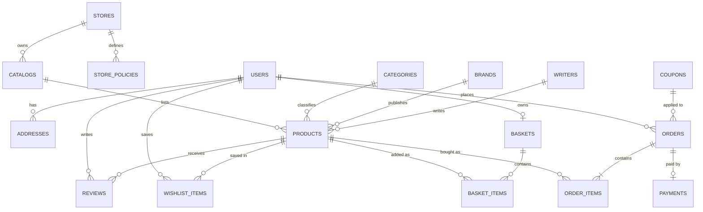

# E-Bookstore Data Model

Derived from the capstone wireframes (slides 5-10) and the architecture diagram (slide 4).
Six domain services are modelled as packages of one Spring Boot application: **member, store, catalog, order, payment, shipping**.
Currency is INR (₹). Table names `users` and `orders` avoid the reserved words `user` / `order`.

## Entity relationship diagram

## Tables

### Member service
**users**
| Column | Type | Notes |
|---|---|---|
| id | bigint PK | |
| first_name, last_name | varchar | |
| email | varchar | unique, login id |
| password_hash | varchar | BCrypt |
| role | varchar | `CUSTOMER` or `ADMIN` |
| gift_points | int | default 0, balance |
| wallet_balance | numeric(12,2) | default 0 |
| created_at | timestamp | |

**addresses** (saved addresses; "Use Saved Address")
| Column | Type | Notes |
|---|---|---|
| id | bigint PK | |
| user_id | FK users | |
| first_name, last_name | varchar | |
| address_line | varchar | |
| email | varchar | |
| phone_country_code, phone | varchar | |
| city, pin, state, country | varchar | |
| is_default | boolean | |

### Store service (ADMIN managed)
**stores**: id, name, active.
**store_policies**: id, store_id FK, title, description.
**catalogs**: id, store_id FK, name, active.

### Catalog service
**categories**: id, name (unique). Seeded with the 19 wireframe categories (Romance ... Language Learning). "All" is a UI filter, not a row.
**brands**: id, name (unique). A brand is the publisher shown on the product page.
**writers**: id, name, bio.

**products** (a book)
| Column | Type | Notes |
|---|---|---|
| id | bigint PK | |
| title | varchar | |
| description | varchar(1000) | short text on the book card |
| back_cover_blurb | varchar(4000) | product page |
| isbn | varchar | unique |
| language | varchar | filter |
| format | varchar | `PAPERBACK`, `HARDCOVER`, `EBOOK` |
| price | numeric(10,2) | ₹ |
| stock | int | |
| delivery_days | int | nullable; falls back to the shipping region rate |
| cover_url | varchar | |
| genre_tags | varchar | comma separated, shown on the card |
| active | boolean | ADMIN sees all, others see active only (entitlement) |
| copies_sold | int | incremented on order, decremented on cancel |
| rating_avg | numeric(3,2) | denormalised from reviews |
| rating_count | int | denormalised from reviews |
| created_at | timestamp | drives "New Launches" |
| category_id, brand_id, writer_id | FK | |
| catalog_id | FK, nullable | |

**reviews**: id, product_id FK, user_id FK, rating (1-5), comment (max 100 chars), created_at. Unique (product_id, user_id).
**wishlist_items**: id, user_id FK, product_id FK, unique pair.

### Order service
**baskets**: id, user_id FK nullable (unique), guest_token varchar nullable (unique). Guests get a server generated token.
**basket_items**: id, basket_id FK, product_id FK, quantity (>= 1), unique (basket, product).
**coupons**: id, code (unique), percent_off, active, expires_at.

**orders**
| Column | Type | Notes |
|---|---|---|
| id | bigint PK | |
| user_id | FK users | |
| status | varchar | `PLACED`, `SHIPPED`, `DELIVERED`, `CANCELLED`, `RETURN_REQUESTED` |
| subtotal, discount, tax, delivery_charge | numeric(12,2) | wireframe totals |
| gift_points_redeemed | int | |
| gift_points_discount | numeric(12,2) | |
| gift_points_earned | int | |
| total_amount | numeric(12,2) | amount paid |
| coupon_code | varchar | nullable |
| ship_* | varchar | snapshot of the delivery address (name, line, email, phone, city, pin, state, country) |
| estimated_delivery | date | latest item delivery date |
| placed_at | timestamp | |
| cancellable_until | timestamp | `placed_at + 48h` |

**order_items**: id, order_id FK, product_id FK, title (snapshot), quantity, unit_price, delivery_date.

### Payment service
**payments**
| Column | Type | Notes |
|---|---|---|
| id | bigint PK | |
| order_id | FK orders | unique |
| method | varchar | `CREDIT_CARD`, `DEBIT_CARD`, `UPI`, `WALLET` |
| status | varchar | `SUCCESS`, `FAILED`, `REFUNDED` |
| amount | numeric(12,2) | |
| card_last4 | varchar(4) | only for card methods |
| transaction_ref | varchar | from the mock gateway |
| created_at, refunded_at | timestamp | |

The full card number, expiry and CVV are validated by the mock gateway and **never persisted**.

### Shipping service
**shipping_rates**: id, region (state name or `DEFAULT`, unique), charge, delivery_days.
Delivery charge is the region flat rate, waived when the subtotal reaches the configured free-shipping threshold.
Tentative delivery date = today + `products.delivery_days`, or the region `delivery_days` when the product value is null.

## Derived rules
- **Recommended for You**: active products in the categories, brands and writers of past purchases, excluding books already bought; falls back to bestsellers.
- **Bestsellers this Month**: highest `copies_sold`. **New Launches**: latest `created_at`.
- **Related Reads**: same category or same writer, excluding the book itself.
- **Buy Again**: re-adds the items of a past order to the basket.
- **Gift points**: 1 point = ₹1 (`app.gift-points.value-per-point`), earned at 1% of the amount paid (`app.gift-points.earn-rate`).
- **Cancel**: allowed while status is `PLACED` and now is before `cancellable_until`; stock, gift points and payment are reversed.
