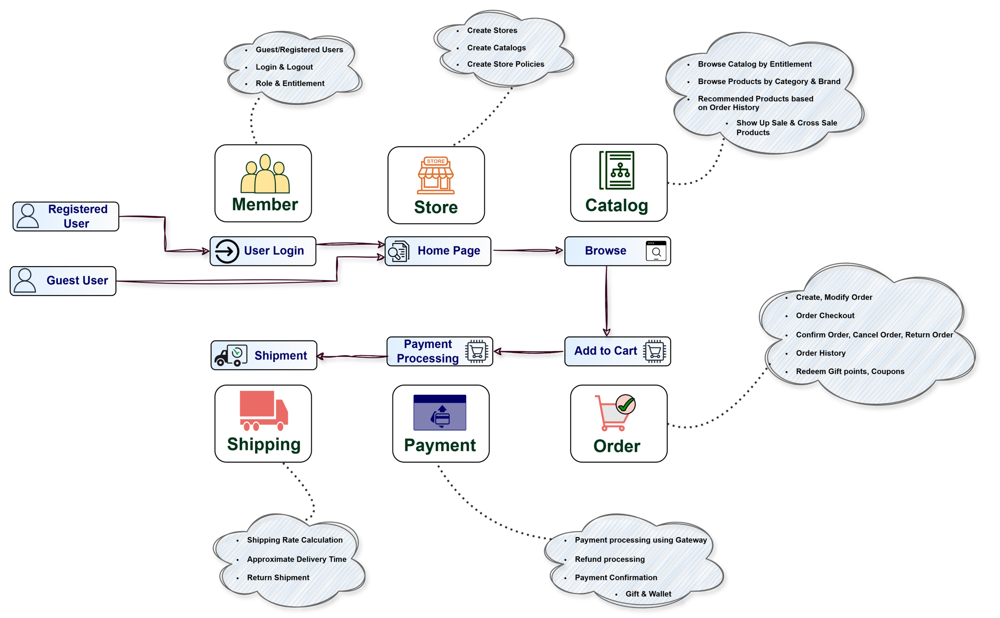
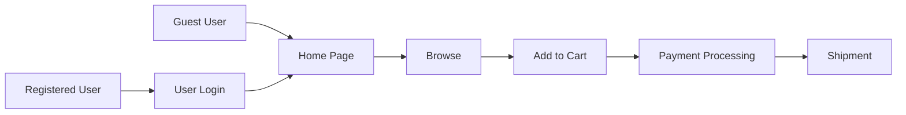
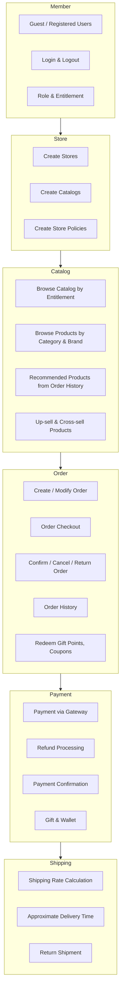

# AI Specialist Capstone Project

*Cloud FullStack – Capstone Instructions*

> Download the latest version of this compendium here: https://w3.ibm.com/services/lighthouse/documents/120180

---

## Objective

This capstone project is your opportunity to move beyond theory and apply AI in a real development workflow. You will leverage Agentic IDEs (such as IBM BOB) to implement a backend solution for an eCommerce application, just like in modern AI-powered engineering teams.

By the end, you won't just understand AI-assisted development; you'll be able to demonstrate it. Remember to focus not just on the outcome, but on how you leverage AI to think, build, and solve problems differently.

### Steps to follow

1. Get access to IBM BOB (fill in the form). You can also use another Agentic IDE such as AWS Kiro.
2. Install the IDE on your local setup (see the Bob installation guidelines).
3. Go through the use case from Slide 3 to Slide 11.
4. Complete the activities listed on Slide 12.
5. Join the Slack channel **#applied-ai-specialist-capstone-project** for any peer or SME help.

**Note:** Any software installed for development can be removed after the development is complete.

---

## Use Case: An E-Commerce Platform to View, Browse and Purchase Books

An online store where a customer can browse, select and buy the selected products.

### Customer Journeys

#### E-Store Home

1. Login page
2. User authentication
   - User browses order history with a "Buy In Again" feature
   - Recommends items based on order history
3. Access the product catalogue for each category

#### Catalogue

5. Select the category of products
6. Browse the brands
7. Select the product (product tagged with tentative delivery date)
   - Related products appear for selection
8. Add the product(s) to basket

#### Payment & Purchase Confirmation

9. Select the address for delivery
10. Initiate payment with the right option
    - Redeem gift points
11. Payment confirmation
12. Confirmation on purchase
    - Cancel order within 48 hours

---

## Architecture



### Customer flow



### Domain services



| Service | Responsibilities |
| --- | --- |
| **Member** | Guest/registered users, login & logout, role & entitlement |
| **Store** | Create stores, catalogs and store policies |
| **Catalog** | Browse by entitlement, category & brand; recommendations from order history; up-sell & cross-sell |
| **Order** | Create/modify order, checkout, confirm/cancel/return, order history, redeem gift points & coupons |
| **Payment** | Gateway payment processing, refunds, payment confirmation, gift & wallet |
| **Shipping** | Shipping rate calculation, approximate delivery time, return shipment |

---

## E-Bookstore Platform to Be Built with an Agentic IDE

The following demonstrates an e-bookstore platform with these characteristics:

- Landing page showing the availability of books
- Selection of books
- Buying the books and committing a payment

*The following slides depict the build of the platform.*

### Catalogue Page

Key features:

- Select the category of products
- Access the product catalogue for each category
- Browse the brands
- Select the product
- Related products appear for selection
- User browses order history with the "Buy In Again" feature

### Shopping Cart

- Add the product(s) to basket
- Recommends items based on order history

### Payment & Purchase: Checkout

- Select the address for delivery
- Initiate payment with the right option
- Redeem gift points

### Payment Screen

- Initiate payment with the right option (e.g., credit card, debit card)
- Complete the payment

### Payment & Purchase: Confirmation

- Confirmation on purchase
- The message should show that the purchase is complete

---

## Technology Components and Workflow

- **Database:** PostgreSQL
- **AI augmentation on UI:** Vibe coding with IBM BOB (or AWS Kiro)
- **Data model design:** Prepare based on wireframes (manual)
- **API spec:** OpenAPI spec generation
- **AI-augmented backend services:** IBM BOB (or AWS Kiro)
- **AI-augmented test case generator:** ICA Agent (choose an agent, e.g., Test Scenario Generator, API Testcase Generator, Test Case Generator for React, etc.)
- **Readiness and deployment:** On a local machine, and if you have cloud environment access (e.g., AWS ROSA or IBM ROKS), you can deploy there
- **PR:** On your personal GitHub, with access provided to your Manager
- **Video:** Record a video describing the steps and submit it to your Manager for review

---

## Backend API Development Workflow with IBM BOB / Kiro

### Step 1: Analyze Wireframe

- Open the wireframe documents referred to in slides 5 to 10
- Identify data entities (Product, User, Order, etc.)
- List required features (search, filter, add to cart, etc.)

### Step 2: Open IBM BOB / Kiro

- Launch the IBM BOB or Kiro tool
- Start a new session for backend development

### Step 3: Generate API Specification

- Upload the wireframe to BOB/Kiro
- Ask: *"Generate OpenAPI specification for this e-commerce wireframe"*
- Specify the entities and operations needed
- Review and save the generated API spec

### Step 4: Generate Spring Boot Code

- Provide the API spec to BOB/Kiro
- Ask: *"Generate Spring Boot application with these APIs"*
- Specify: Java version, database type (MySQL/H2), dependencies needed
- Download/copy the generated code

### Step 5: Set Up the Project Locally

- Extract/organize the generated code
- Open in an IDE (IntelliJ, VS Code)
- Review the project structure (controllers, services, repositories, entities)

### Step 6: Configure Database

- Install PostgreSQL Community Edition from the PostgreSQL downloads page (as per your local OS)
- Update the `application.properties` file:
  - Set database connection details
  - Configure port and application name

### Step 7: Run Application

- Build the project: `./mvn clean install`
- Start the application: `./mvn spring-boot:run`
- Verify the application starts without errors

### Step 8: Test APIs

- Open an API testing tool such as Insomnia, or use a browser
- Test each endpoint (GET, POST, PUT, DELETE)
- Verify responses match the API specification
- Check that data is saved in the database

### Step 9: Git Check-in

```bash
git init                                   # if new project
git checkout -b feature/api-implementation
git add .
git commit -m "Implement Spring Boot API for e-commerce"
git push origin feature/api-implementation
```

Then create a Pull Request with the API documentation.

---

Raise any questions through the Slack channel **#applied-ai-specialist-capstone-project**.
